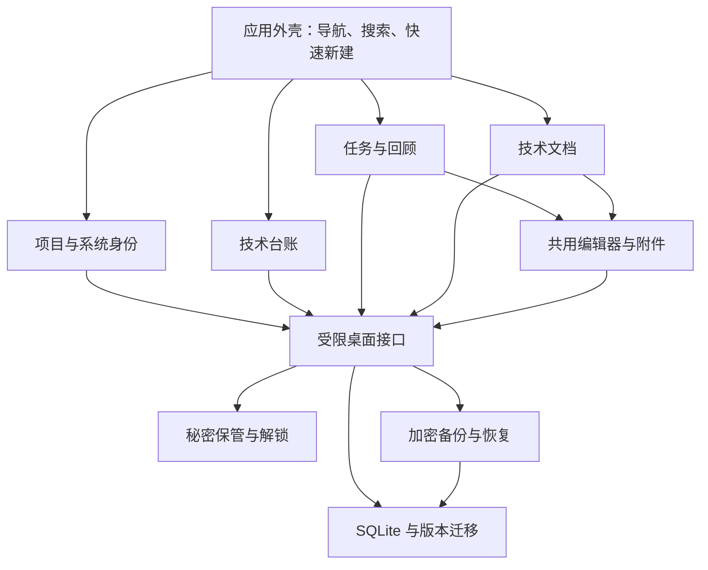

# Clever Workbench 技术方案

本文服务于 [正式需求规格](spec.md)，已随 Q20 获整体确认。用户随后明确授权直接开始编码，当前进入实现。技术选择为 Electron、React、TypeScript 和 SQLite，沿用现有任务代码并整理职责；以下目录组织仍属于实施建议，用户行为和验收范围以正式规格为准。

## 应用结构

每个模块通过少量查询与操作完成自身工作。编辑器内部处理格式、图片与保存协调；台账页面不需要了解图片格式或文件路径。秘密保管内部处理主密码、加密、会话与锁定；普通查询只返回账号元数据。

## 最小职责划分

| 模块或能力 | 负责内容 | 接入方式 |
| --- | --- | --- |
| 应用外壳 | 窗口布局、页面入口、搜索与命令、当前上下文 | 组合各模块的入口定义 |
| 项目与系统 | 稳定身份、当前与历史项目关联、归档规则 | 查询对象与执行明确操作 |
| 技术台账 | 环境、服务、部署信息、资源与账号元数据 | 通过标识引用秘密，不在普通查询中取秘密 |
| 任务 | 任务状态、时间规则、项目归类和回顾图 | 复用现有业务计算与有效测试 |
| 文档 | 正文、对象关联、检索与回收站 | 使用共用编辑器和附件能力 |
| 秘密保管 | 保存、查看、复制、解锁、锁定及主密码变更 | 仅主进程持有可解密的会话材料 |
| 数据与备份 | 迁移、事务、一致快照、附件、完整加密与恢复 | 跨模块协调完整资料库 |

首版保留单仓库与单应用，不为每个模块引入独立服务或包发布流程。目录可按 `src/app`、`src/features`、`src/shared` 与 `electron` 分开；只有实际共用能力进入 shared。

## 新模块如何进入应用

内置模块登记稳定标识、显示名称、图标、页面入口及可用操作。需要参与检索时再提供搜索结果，统一返回对象类型、标识、标题、所属上下文和定位信息。

应用外壳据此渲染导航与命令列表；新增工具主要提交自己的模块和一项登记。普通模块使用同一套对象定位方式，例如从搜索结果直接打开某个账号或文档。暂不增加动态加载、插件市场、跨进程插件协议或无代码工具编辑器。

## 数据关系

- 项目和系统分别拥有稳定标识，以关联记录保留历史，并为系统标记至多一个当前项目。
- 环境与服务归属于系统；服务公共信息与环境部署信息分开，避免仓库地址在多个环境重复维护。
- 资源归属于系统环境，首版不跨系统共享。资源按常用类型提供轻量字段模板，其余信息按需补充。
- 账号归属于系统环境或具体资源；用户名和用途是普通信息，密码、Token、私钥是独立加密内容。
- 任务和文档可保留创建时的项目及相关对象引用；改变系统的当前项目不执行历史记录的批量重挂。
- 业务标识不依赖显示名称，重命名不破坏关联。归档与回收站保留资料；存在引用的父对象不执行未经处理的级联物理删除。

系统和项目的关系依据 [ADR 0002](../../docs/adr/0002-system-identity-across-projects.md)，具体行为约束以正式需求规格为准。

## 现有代码如何复用

保留任务的状态与时间规则、列表和时间线计算、有效的存储测试、图片导入与保存协调。将现有页面中的业务拆入任务模块，桌面隔离和备份流程作为基础继续完善。

新应用使用独立的 appId、产品名、资料目录、附件协议和备份格式，不写入 Clever Plan 的资料目录。旧程序的三表校验与 `clever-plan` 备份格式不直接沿用；为工作台的新模型建立统一版本迁移和恢复校验。

## Markdown 与图片

建立一个共用编辑模块，任务和文档使用相同的正文、源码切换和图片接口。原有 Tiptap 配置可作为起点，但先验证表格、任务清单、代码块和图片的往返行为。

正文版本须有单一权威来源。以 Markdown 正文为保存与源码编辑的依据，富文本状态作为编辑表示；切换前完成转换校验，未支持的结构保留源码，不以不完整的富文本结果覆盖原文。具体编辑器实现封装在模块内部，调用方只负责加载、保存和处理错误。

图片保存为受控的本地附件，通过稳定标识引用。文件导入、大小与格式校验、附件路径解析放在主进程；备份包含当前资料、草稿与可恢复删除内容仍然引用的附件。

## 秘密保护与加密备份

遵循 [ADR 0004](../../docs/adr/0004-encrypt-secrets-on-demand.md)。主进程验证访问来源和参数；普通 renderer 查询不返回秘密，复制秘密由主进程完成。显示秘密需要明确操作，显示状态在锁定后撤销。主密码及解密材料不进入日志或普通状态存储。

采用成熟的密码派生和认证加密原语，使用随机盐、唯一 nonce、版本化参数及完整性验证；密钥派生的耗时与内存参数在目标硬件校准。优先使用 [Node crypto](https://nodejs.org/api/crypto.html) 中已支持的成熟能力，不自行设计加密算法。

秘密解锁材料与自动备份材料分离。自动备份可以使用仅足以封装备份的本机材料，但不能因此取得秘密解密能力；跨设备恢复材料受用户主密码保护并随加密备份保存，不仅依赖原机器的系统密钥。锁定、主密码变更、旧备份恢复和本机材料丢失的行为先通过专项测试验证，再接入页面。

完整备份包含 SQLite 一致快照、引用附件和版本清单，再整体加密。恢复在隔离目录校验、解密及检查结构，全部成功后才替换当前资料。参数与包大小在认证前也要限制，避免损坏文件触发无界资源消耗。

本机普通资料与秘密加密、导出完整包加密是不同的保护范围，页面说明与测试分别验证两者。

## 实施顺序与验证

1. **建立应用外壳并接入任务模块**：启动目标平台窗口，建立统一入口、对象定位和设计变量；保留任务回顾行为并跑现有相关测试。
2. **实现系统、项目与台账**：验证历史项目切换、跨环境服务、多角色账号元数据及轻量录入。
3. **接入秘密保管和完整备份**：先验证错误密码、锁定、篡改、密码变更及跨设备恢复，再允许保存真实秘密。
4. **接入独立文档和共用编辑器**：补齐表格与源码切换，验证图片、草稿及退出恢复；加入全局搜索与关联跳转。
5. **完成视觉与双平台验收**：检查主题、键盘、窗口、剪贴板和可访问性，生成目标平台安装包并记录实际验证结果。

业务测试聚焦易出错的关系和数据保护，不为静态样式或简单映射堆测试。桌面 E2E 覆盖三条高频流程、编辑退出、锁定和完整恢复。Windows 构建成功不能替代 Windows 运行与安装验收；若执行环境不足，明确记录尚未完成的项目。

首版用于个人使用，正式签名、公证和自动更新在具备相应证书及分发需求后再决定；这不影响先完成本地应用与安装包的功能验收。
