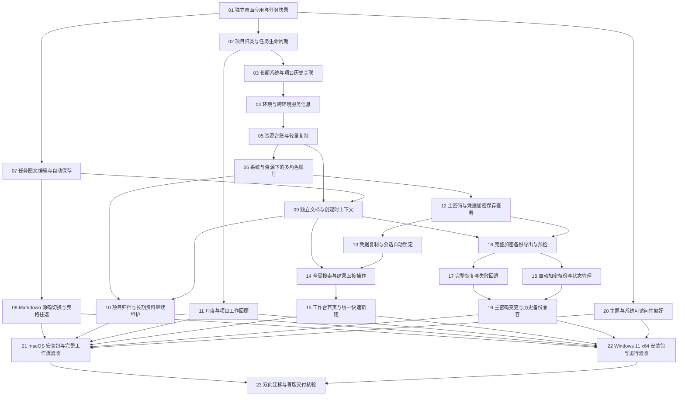

# Clever Workbench 开发任务

方案状态：23 项任务拆分已获用户确认并发布。
执行范围：用户已明确授权直接编码，按任务依赖自主实施直到完成。

依据：[正式需求规格](spec.md)、[技术方案](technical-plan.md)。规格及其状态保持不变。

## 拆分方式

共 23 个可独立演示或验证的完整交付单元，每个任务都有独立文档、直接前置依赖、可检查的验收标准和演示路径。每项任务单独发布到正式任务目录并标记为 `ready-for-agent`；该状态表示任务定义齐备，不自动表示已经开始执行。

编号采用依赖在前的拓扑顺序，不代表必须从头到尾串行。正式执行时只需等待任务自身的直接前置完成；这里不重复列出传递依赖，也不额外要求等待同一批其他任务。

任务 01 先在新应用中整理可复用的最小任务能力，再交付快录与完成流程，避免先开一个只有目录和框架、无法演示的搭架子任务。后续每项都沿着自身的界面、公开操作、持久化和验证完成一条实际行为。

## 共用完成标准

- 任务文档已获确认并获得明确实施授权。从依赖已完成的任务中开始，认领后记录实现与验证证据。
- 每个任务的验收项全部有证据后才可视为完成；只做界面、只建数据结构或用假数据演示不满足完整交付。
- 只通过公开操作和用户可见结果验证行为，使用隔离资料库与虚构秘密；保护已有通过的行为，不因拆分删除必要校验。
- 页面从接入时就遵循已确认的视觉与键盘规则。任务 20 交付偏好与系统响应，不能成为其他页面延后设计或可访问性的理由。
- 每次增加持久化资料都同步维护版本迁移与引用关系。任务 16 建立备份后，后续资料变化必须同步验证导出、预检和恢复兼容性，不能因任务编号靠后而漏掉备份。
- 新应用和任何验证均不写入原 Clever Plan 的资料；需要复用的整理先在新应用中完成，再加入本任务的新行为。
- 任务完成不等于整款应用可交付；任务 21、22 验证真实平台产物，任务 23 验证双向迁移。

## 编号任务清单

1. **[独立桌面应用与任务快录](issues/01-desktop-task-capture.md)**
   - 前置：无技术前置。
   - 交付：在新工作台中离线创建、查看并完成一条任务，关闭后重启仍能看到结果；这条真实流程同时建立新应用身份和可扩展入口。

2. **[项目归类与任务生命周期](issues/02-project-task-lifecycle.md)**
   - 前置：[01](issues/01-desktop-task-capture.md)。
   - 交付：把任务归类到项目，筛选、修改、完成、撤销、重开、删除和恢复任务，保留准确的创建与业务时间。

3. **[长期系统与项目历史关联](issues/03-system-project-history.md)**
   - 前置：[02](issues/02-project-task-lifecycle.md)。
   - 交付：创建长期系统，为其关联历史项目并标记当前项目；切换当前项目后，系统身份和已有任务的项目归属保持不变。

4. **[环境与跨环境服务信息](issues/04-environment-service-deployment.md)**
   - 前置：[03](issues/03-system-project-history.md)。
   - 交付：在系统下按需建立环境和服务，仓库等公共信息只录一次，测试与生产各自维护部署地址和端口。

5. **[资源台账与轻量复制](issues/05-resource-ledger-copy.md)**
   - 前置：[04](issues/04-environment-service-deployment.md)。
   - 交付：在环境中记录 Redis、服务器和其他资源，快速修改或复制普通字段，并直接复制地址或打开明确链接。

6. **[系统与资源下的多角色账号](issues/06-multi-role-account-ledger.md)**
   - 前置：[05](issues/05-resource-ledger-copy.md)。
   - 交付：在系统环境或具体资源下维护超管、业务角色等多个账号，快速查询用途、用户名和归属。

7. **[任务图文编辑与自动保存](issues/07-task-markdown-images-autosave.md)**
   - 前置：[01](issues/01-desktop-task-capture.md)。
   - 交付：在任务详情里编辑基础 Markdown、选择或粘贴截图，并在切换、关闭与重启后保留正文和本地图片。

8. **[Markdown 源码切换与表格往返](issues/08-markdown-source-roundtrip.md)**
   - 前置：[07](issues/07-task-markdown-images-autosave.md)。
   - 交付：在同一正文的即时排版与 Markdown 源码之间切换，安全编辑表格、代码块、清单和图片引用。

9. **[独立文档与创建时上下文](issues/09-documents-context-links.md)**
   - 前置：[05](issues/05-resource-ledger-copy.md)、[07](issues/07-task-markdown-images-autosave.md)。
   - 交付：直接新建问题与方案文档，或从系统、环境、资源中带入创建时的背景；文档可查询、编辑、跳回对象和从回收站恢复。

10. **[项目归档与长期资料继续维护](issues/10-project-archive-continuity.md)**
   - 前置：[06](issues/06-multi-role-account-ledger.md)、[09](issues/09-documents-context-links.md)。
   - 交付：归档结束的项目并保留历史，长期系统和账号所属资源继续可维护；在恢复、重开与回收站恢复时保持一致的项目状态。

11. **[月度与项目工作回顾](issues/11-task-retrospective-timeline.md)**
   - 前置：[02](issues/02-project-task-lifecycle.md)。
   - 交付：按月或项目查看任务回顾甘特图，清楚呈现已完成和仍在延续的工作，并能从时间条打开任务。

12. **[主密码与凭据加密保存查看](issues/12-vault-secret-roundtrip.md)**
   - 前置：[06](issues/06-multi-role-account-ledger.md)。
   - 交付：首次设置主密码，为一个账号安全保存密码、Token 或私钥；重启后按需解锁查看秘密，普通资料仍然可访问。

13. **[凭据复制与会话自动锁定](issues/13-secret-copy-session-lock.md)**
   - 前置：[12](issues/12-vault-secret-roundtrip.md)。
   - 交付：按需解锁后直接复制秘密，连续操作不重复询问；闲置、锁屏、退出和手动锁定后恢复保护，并管理本次秘密剪贴板。

14. **[全局搜索与结果直接操作](issues/14-global-search-actions.md)**
   - 前置：[09](issues/09-documents-context-links.md)、[13](issues/13-secret-copy-session-lock.md)。
   - 交付：在一个入口搜索普通台账、任务和文档，结果标明上下文，直接打开对象或按权限状态复制账号信息。

15. **[工作台首页与统一快速新建](issues/15-workbench-home-quick-actions.md)**
   - 前置：[14](issues/14-global-search-actions.md)。
   - 交付：默认打开覆盖三个高频动作的工作台，展示常用系统和账号、未完成任务、最近文档，并在各主要页面快速新建。

16. **[完整加密备份导出与预检](issues/16-encrypted-backup-export-inspect.md)**
   - 前置：[09](issues/09-documents-context-links.md)、[12](issues/12-vault-secret-roundtrip.md)。
   - 交付：在设置中导出包含全部当前资料与附件的加密备份，并能验证密码、完整性、版本及内容数量，供后续恢复使用。

17. **[完整恢复与失败回退](issues/17-backup-restore-rollback.md)**
   - 前置：[16](issues/16-encrypted-backup-export-inspect.md)。
   - 交付：从已验证的完整备份恢复工作台，确认前展示内容摘要，替换前保留原资料副本，失败时当前工作仍可继续。

18. **[自动加密备份与状态管理](issues/18-automatic-encrypted-backups.md)**
   - 前置：[16](issues/16-encrypted-backup-export-inspect.md)。
   - 交付：有变更时自动生成每日加密备份，保留最近 7 份，展示成功或失败状态并允许重试和选择目录。

19. **[主密码变更与历史备份兼容](issues/19-master-password-change.md)**
   - 前置：[17](issues/17-backup-restore-rollback.md)、[18](issues/18-automatic-encrypted-backups.md)。
   - 交付：在设置中更改主密码，后续使用新密码保护当前资料与新备份，历史备份仍使用生成时的旧密码恢复。

20. **[主题与系统可访问性偏好](issues/20-theme-accessibility-preferences.md)**
   - 前置：[01](issues/01-desktop-task-capture.md)。
   - 交付：选择浅色、深色或跟随系统，并让窗口、界面材质、动态效果和键盘焦点响应平台与可访问性设置。

21. **[macOS 安装包与完整工作流验收](issues/21-macos-personal-release.md)**
   - 前置：[08](issues/08-markdown-source-roundtrip.md)、[10](issues/10-project-archive-continuity.md)、[11](issues/11-task-retrospective-timeline.md)、[15](issues/15-workbench-home-quick-actions.md)、[19](issues/19-master-password-change.md)、[20](issues/20-theme-accessibility-preferences.md)。
   - 交付：生成可在目标 Apple Silicon Mac 上安装运行的个人使用版本，并在打包产物中完成真实工作流程验收。

22. **[Windows 11 x64 安装包与运行验收](issues/22-windows-personal-release.md)**
   - 前置：[08](issues/08-markdown-source-roundtrip.md)、[10](issues/10-project-archive-continuity.md)、[11](issues/11-task-retrospective-timeline.md)、[15](issues/15-workbench-home-quick-actions.md)、[19](issues/19-master-password-change.md)、[20](issues/20-theme-accessibility-preferences.md)。
   - 交付：生成 Windows 11 x64 个人使用安装包，并在实际 Windows 环境运行核心流程，确认窗口、剪贴板、图片、锁定与资料操作可用。

23. **[双向迁移与首版交付核验](issues/23-cross-platform-migration-acceptance.md)**
   - 前置：[21](issues/21-macos-personal-release.md)、[22](issues/22-windows-personal-release.md)。
   - 交付：证明 Mac 与 Windows 的完整资料可以双向迁移，并将用户可安装的首版产物、验收结果与使用边界一同交付。

## 依赖图

## 执行入口与可并行分支

当前已获得实施授权，第一个技术起点为任务 01。其完成后，任务 02、07、20 的技术前置同时满足，可独立推进。台账沿系统、环境、资源、账号逐步建立；图文编辑无需等待整套台账；回顾只依赖已有任务生命周期。

秘密保管验证完成后，再将其接入复制、搜索和备份。备份导出与预检完成后，恢复和自动调度可以独立推进；主密码变更依赖实际恢复和自动备份能力，以便同时验证历史备份的密码口径及变更后的持续备份。

Mac 与 Windows 平台任务具有同样的功能前置，彼此不阻塞。只有双向迁移任务同时依赖两端真实产物，不把交叉打包当作 Windows 运行成功。

## 规格覆盖与文档发布

[覆盖表](ticket-coverage.md) 将 82 条用户故事和 17 个测试场景映射到任务。多个任务共同覆盖一个故事时，需要相关任务一起完成，不能把其中一个完成当作整个故事已经交付。

当前检查结果：82／82 用户故事、17／17 测试场景均有对应任务；依赖没有循环、未知编号或重复列出的传递前置。该检查只证明文档覆盖和依赖结构，不代表应用或测试已经实现。

用户已确认拆分，23 份任务已单独发布并标记 `ready-for-agent`，文档链接已更新。用户随后明确要求直接编码，当前进入实现阶段。

